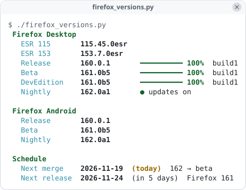
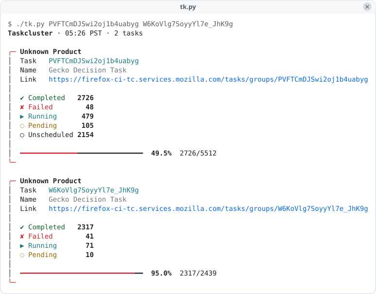

# Status

Terminal tools to check what Firefox versions are shipping and how release
task groups are doing in Taskcluster.

| Script | What it does |
| --- | --- |
| [`firefox_versions.py`](#firefox_versionspy) | Shipped Firefox Desktop and Android versions, rollout rates, Nightly update status and the next merge and release dates |
| [`tk.py`](#tkpy) | Status of one or more Taskcluster task groups: task counts per state and a completion bar |

Both scripts need Python 3 and use only the standard library. Output is
colored in a terminal and plain when piped or when `NO_COLOR` is set.
Dates and times use your machine's local timezone.

A handy setup is a shell alias for each:

```sh
alias v="$HOME/path/to/Relman/scripts/status/firefox_versions.py"
alias tk="$HOME/path/to/Relman/scripts/status/tk.py"
```

## firefox_versions.py

Shows at a glance what is shipped on each channel. It takes no arguments.

<picture>
  <source media="(prefers-color-scheme: dark)" srcset="docs/firefox_versions-dark.svg">
  
</picture>

<details>
<summary>Same output as text</summary>

```console
$ ./firefox_versions.py

 Firefox Desktop
   ESR 115       115.45.0esr
   ESR 153       153.7.0esr
   Release       160.0.1       ━━━━━━━━━━ 100%  build1
   Beta          161.0b5       ━━━━━━━━━━ 100%  build1
   DevEdition    161.0b5       ━━━━━━━━━━ 100%  build1
   Nightly       162.0a1       ● updates on

 Firefox Android
   Release       160.0.1
   Beta          161.0b5
   Nightly       162.0a1

 Schedule
   Next merge    2026-11-19  (today)  162 → beta
   Next release  2026-11-24  (in 5 days)  Firefox 161
```

</details>

What each part means:

- **Versions** come from [product-details](https://product-details.mozilla.org/1.0/).
  ESR rows are labeled from their version numbers, so a new ESR shows up
  without changing the script.
- **The rollout bar** is the Balrog `backgroundRate` for the release, beta
  and devedition rules ([AUS API](https://aus-api.mozilla.org/api/v1/)),
  followed by the build the rule points to. If Balrog serves a different
  version from the one in product-details, the version is shown before the
  build, e.g. `160.0 build2`. A partial rollout looks like this:

  ```
     Beta          161.0b5       ━━────────  25%  build1
  ```

- **Nightly** shows whether Nightly updates are on, or stopped through an
  emergency shutoff in Balrog. When they are stopped, the reason is printed
  along with a Bugzilla link to the bugs it mentions:

  ```
     Nightly       162.0a1       ● UPDATES STOPPED
       Stopped for bug 1999999 and bug 2000001
       https://bugzilla.mozilla.org/buglist.cgi?bug_id=1999999%2C2000001
  ```

- **Schedule** gives the next merge day and release date from
  [whattrainisitnow.com](https://whattrainisitnow.com/), relative to your
  local date. Version numbers there come from product-details: the current
  Nightly merges to Beta, and the next release is the current release + 1.

If an API cannot be reached, the affected rows say so instead of showing
stale or wrong data:

```
   Release       n/a           rollout unavailable
   Nightly       n/a           update status unavailable
   Next merge    n/a
```

## tk.py

Shows the state of one or more Taskcluster task groups, typically the
release promotion actions (promote, push, ship) started from Ship It. Pass
the task group IDs as arguments. They are fetched in parallel.

<picture>
  <source media="(prefers-color-scheme: dark)" srcset="docs/tk-dark.svg">
  
</picture>

<details>
<summary>Same output as text</summary>

```console
$ ./tk.py PVFTCmDJSwi2oj1b4uabyg W6KoVlg7SoyyYl7e_JhK9g

Taskcluster · 05:26 PST · 2 tasks

╭─ Unknown Product
│  Task   PVFTCmDJSwi2oj1b4uabyg
│  Name   Gecko Decision Task
│  Link   https://firefox-ci-tc.services.mozilla.com/tasks/groups/PVFTCmDJSwi2oj1b4uabyg
│
│  ✔ Completed   2726
│  ✘ Failed        48
│  ▶ Running      479
│  ◌ Pending      105
│  ○ Unscheduled 2154
│
│  ━━━━━━━━━━━━━━━━━━━━━━━━━━━━━━  49.5%  2726/5512
╰─

╭─ Unknown Product
│  Task   W6KoVlg7SoyyYl7e_JhK9g
│  Name   Gecko Decision Task
│  Link   https://firefox-ci-tc.services.mozilla.com/tasks/groups/W6KoVlg7SoyyYl7e_JhK9g
│
│  ✔ Completed   2317
│  ✘ Failed        41
│  ▶ Running       71
│  ◌ Pending       10
│
│  ━━━━━━━━━━━━━━━━━━━━━━━━━━━━━━  95.0%  2317/2439
╰─
```

</details>

How to read a card:

- **The header** shows the product and version for release promotion
  tasks, e.g. `Firefox Desktop 161.0b5`, read from the action's
  `release_promotion_flavor` and version. Other tasks, like the decision
  tasks above, show `Unknown Product`.
- **The card color** is red if any task failed or hit an exception, green
  when every task is completed, and yellow while the group is in progress.
- **The bar** counts only completed tasks, so failed tasks keep it below
  100%.
- If a task exists but has no task group yet, its own state is shown
  instead, e.g. `◌ pending  (not started yet, no task group)`.

An ID that Taskcluster does not know gets an error card:

```
$ ./tk.py NotARealTaskIdXXXXXXXX

Taskcluster · 05:26 PST · 1 task

╭─ ✘ Unknown task
│  Task   NotARealTaskIdXXXXXXXX
│  Error or no data returned by Taskcluster
╰─
```

### Requirements

`tk.py` calls the [Taskcluster CLI](https://github.com/taskcluster/taskcluster/tree/main/clients/client-shell).
Download the binary for your platform from the
[Taskcluster releases](https://github.com/taskcluster/taskcluster/releases),
make it executable and put it on your `PATH` or in this folder, named
`taskcluster`. A copy in this folder takes precedence over the one on your
`PATH`.

The task data it reads is public, so you do not need to sign in.
`TASKCLUSTER_ROOT_URL` defaults to Firefox CI
(`https://firefox-ci-tc.services.mozilla.com`) when it is not set.

Without the CLI, the script stops with:

```
The taskcluster CLI is not installed or not executable: …/scripts/status/taskcluster
Get it from https://github.com/taskcluster/taskcluster/tree/main/clients/client-shell
```

## Updating the screenshots

GitHub markdown cannot show terminal colors, so the examples above are SVG
images made from the real colored output by [`docs/ansi2svg.py`](docs/ansi2svg.py)
(standard library only). Each image comes in a dark and a light version, and
GitHub shows the one matching the reader's theme.

To regenerate them, run from this folder, with the task group IDs to show in
the `tk.py` example:

```sh
docs/screenshots.sh TASK_ID [TASK_ID ...]
```

It runs each script once, writes `docs/*-dark.svg` and `docs/*-light.svg`,
and prints the same output as plain text to paste in the "Same output as
text" blocks, so the text matches the images.

`ansi2svg.py` can also make other styles: `--chrome` sets the window
decoration (`gnome`, `macos`, `windows`, `none`) and `--theme` the color
scheme (`github-dark`, `github-light`, `catppuccin-mocha`, `solarized-dark`,
`dracula`). See `docs/ansi2svg.py --help`.
